# Comparación de las direcciones

Las cinco identidades sobre las mismas pantallas y los mismos datos: la API simulada de e2e, con las respuestas y las
portadas reales del backend. En cada hoja aparecen, de izquierda a derecha, **Papel y tinta** (la de hoy), **Gaceta**,
**Pulso**, **Musgo** y **Atlas**.

## Resumen

|                          | Papel y tinta (hoy)      | Gaceta                  | Pulso                            | Musgo               | Atlas                             |
| ------------------------ | ------------------------ | ----------------------- | -------------------------------- | ------------------- | --------------------------------- |
| Concepto                 | Papel cálido y terracota | Revista literaria       | App de consumo con energía       | Calma natural       | Precisión premium y geometría     |
| Marca                    | Terracota `#a8402a`      | Oxblood `#7a1f2b` y oro | Índigo `#4a3fd6` y coral         | Musgo `#2f5e45`     | Ultramar `#1c3fd1` y bermellón    |
| Titulares                | Newsreader               | Fraunces                | Plus Jakarta Sans 800            | Source Serif 4      | Geist 600                         |
| Lectura                  | Newsreader               | Source Serif 4          | Literata                         | Source Serif 4      | Newsreader                        |
| Interfaz                 | Source Sans 3            | IBM Plex Sans           | Plus Jakarta Sans                | Manrope             | Geist                             |
| Forma                    | Píldoras, tarjetas de 18 | Rectas (2–6), filetes   | Muy redondeada (24–28), píldoras | Orgánica (22), hoja | Rectas (6) con píldoras, círculos |
| Primera carga de fuentes | 156 KB                   | 228 KB                  | 133 KB                           | 143 KB              | 156 KB                            |
| Oscuro                   | Grafito y salmón         | Azul tinta y rosa vino  | Azul profundo y lavanda          | Bosque y salvia     | Negro y pervinca                  |

## Matriz (1 = flojo, 5 = excelente)

Es una valoración razonada a partir de las capturas, las medidas de contraste y el coste; no es un estudio con usuarios.

| Criterio                      | Papel y tinta | Gaceta | Pulso | Musgo | Atlas  |
| ----------------------------- | ------------- | ------ | ----- | ----- | ------ |
| Distinción de marca           | 3             | **5**  | 4     | 3     | 4      |
| Aspecto profesional           | 4             | **5**  | 4     | 4     | **5**  |
| Comodidad de lectura          | **5**         | **5**  | 4     | **5** | 4      |
| Memorabilidad                 | 3             | **5**  | 4     | 3     | 4      |
| Atractivo emocional           | 4             | 4      | **5** | 4     | 3      |
| Usabilidad móvil              | 4             | 4      | 4     | 4     | **5**  |
| Coherencia web y móvil        | 4             | 4      | 4     | 4     | **5**  |
| Accesibilidad                 | **5**         | **5**  | 4     | 4     | **5**  |
| Escalabilidad a largo plazo   | 4             | 3      | 4     | 4     | **5**  |
| Encaje con el autoaprendizaje | 4             | 4      | **5** | 4     | 4      |
| **Total (50)**                | 40            | **44** | 42    | 39    | **44** |

Por qué:

- **Gaceta** gana en marca y memorabilidad porque la firma (filetes, Fraunces, oxblood) es reconocible sin portadas.
  Pierde en escalabilidad: tres familias y una disciplina de filetes que cada componente nuevo tiene que respetar.
- **Atlas** gana en coherencia y escalabilidad porque la geometría se extiende sin ilustrador y Geist se porta igual en
  web y Flutter. Pierde en calidez.
- **Pulso** es la más emocional y la mejor para sostener el hábito. Baja en lectura (la interfaz fría alrededor del
  papel) y en accesibilidad (más color y más estados que vigilar).
- **Musgo** es la más descansada, pero la menos memorable, y su verde choca con el `success`.
- **Papel y tinta** sigue siendo muy buena para leer; su problema es que se distingue poco.

## Accesibilidad medida

- **Contraste:** las cuatro direcciones pasan el contrato de contraste de `lesen.test.ts` en sus cinco temas:
  - Texto a 4,5:1 y marcas a 3:1.
  - La tinta del lector a 7:1 o más.
  - La destacada de color de marca de Pulso, también.
  - El generador (`scripts/design-directions.mjs`) no escribe una dirección si un par falla. Solo hubo que corregir el
    `success` de Pulso en sepia, que daba 4,45:1.
- **axe:** WCAG 2.2 AA en las 18 pantallas y en el contraste de los tres temas del lector, con cada dirección inyectada
  sobre la build de producción (`A11Y_DIRECTION`), en claro y en oscuro. Pasan las 10 combinaciones (21 pruebas cada una).
- **Sin cambios:** objetivos de 44 px, foco visible y ningún estado solo por color. Las direcciones no tocan ningún
  componente.

## Web

### Descubrir

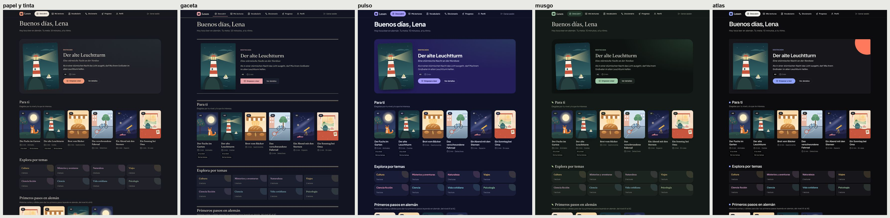
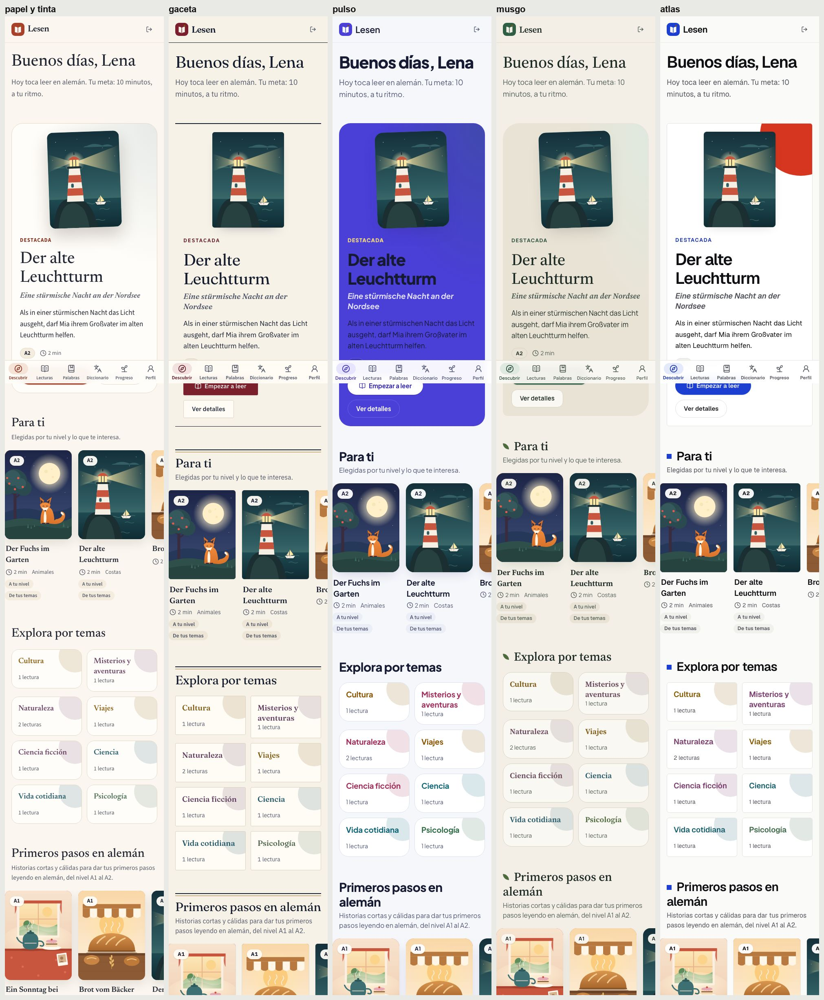

### Catálogo y detalle

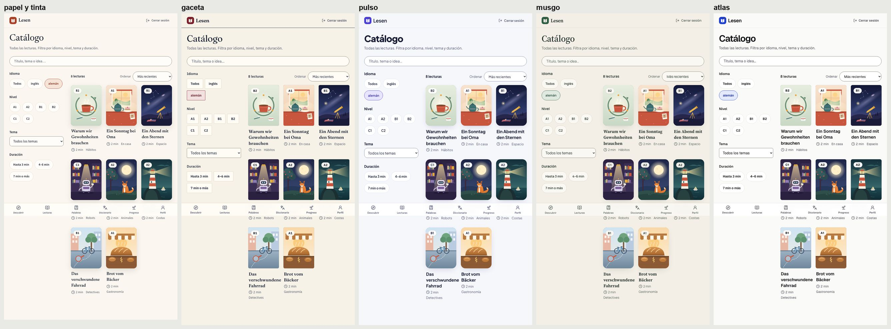
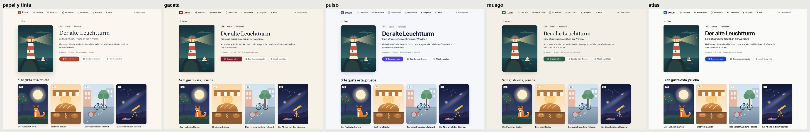

### Lector

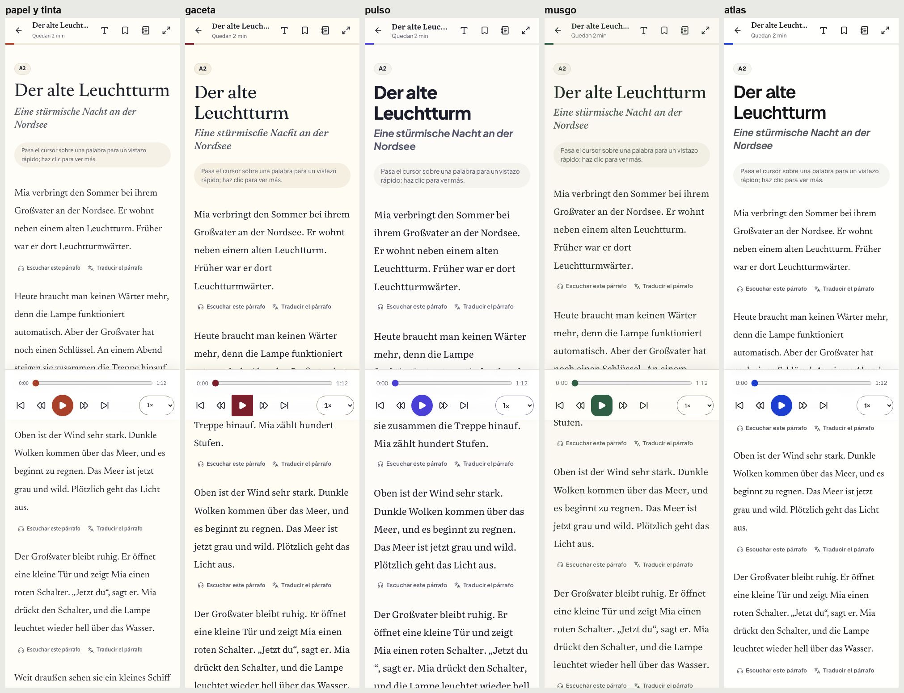
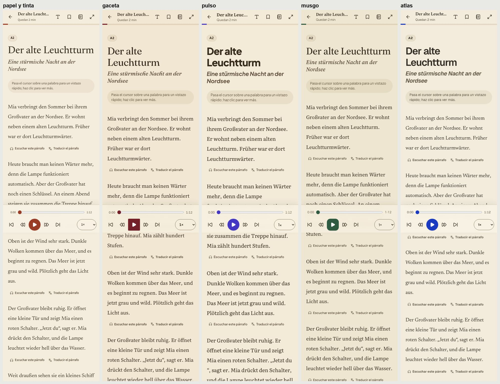
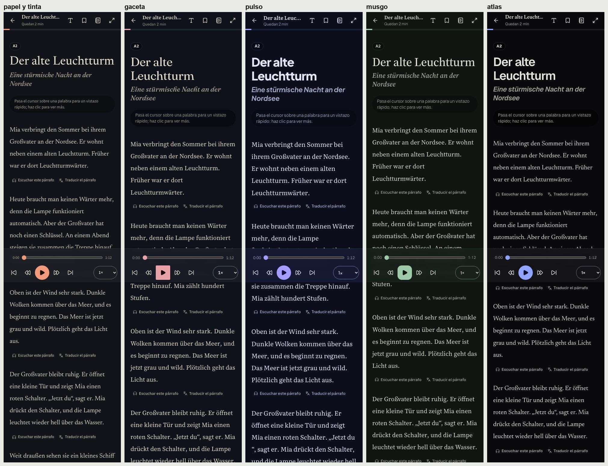
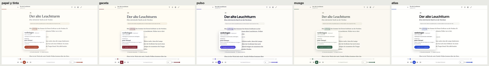

### Vocabulario, progreso y perfil

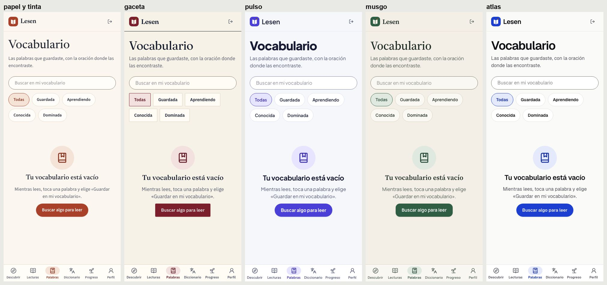
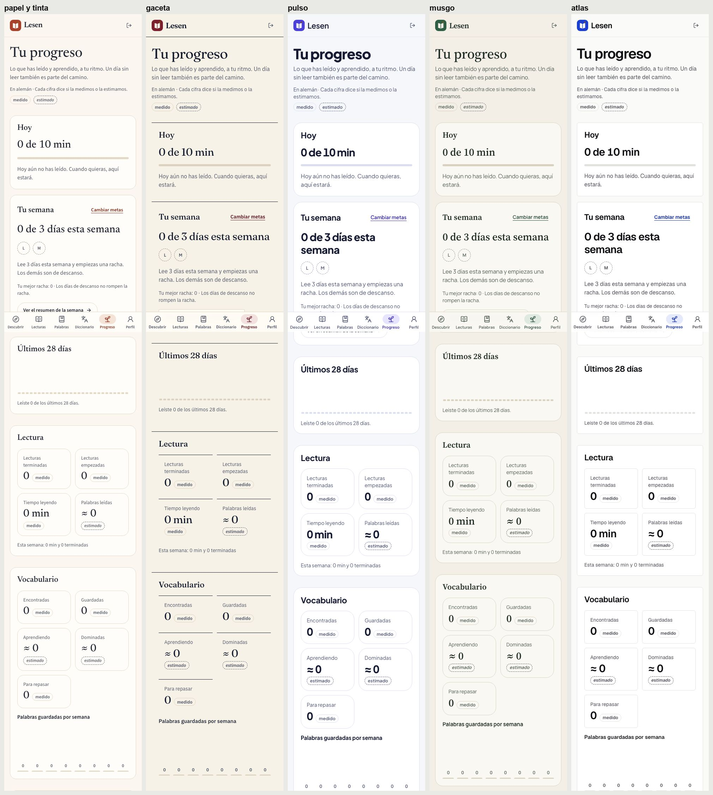
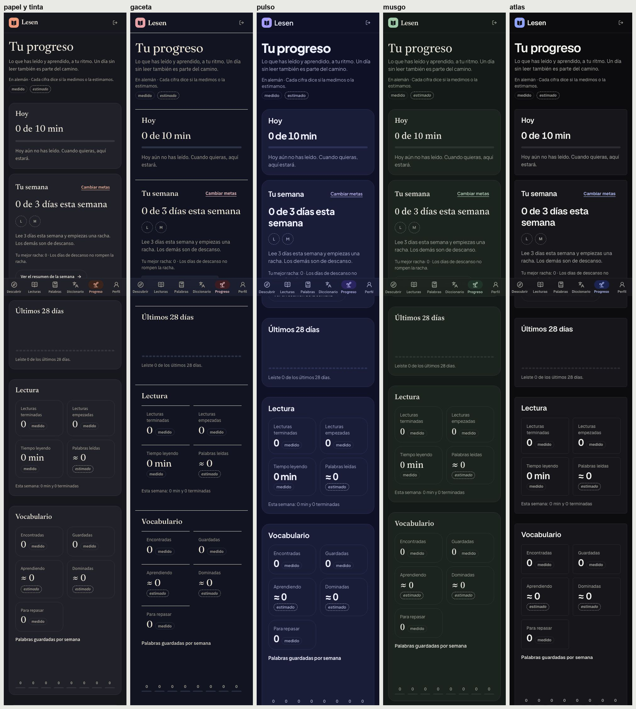
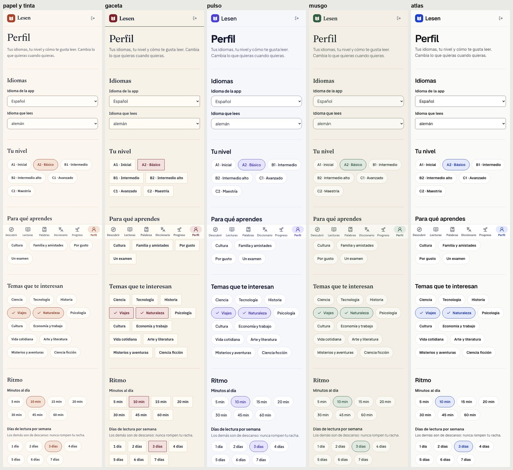

Las capturas completas, de 14 pantallas a seis anchos en claro y en oscuro, se generan en local con
`VISUAL_DIRECTION=<id> yarn e2e:visual`. Dependen del sistema, así que no van al repositorio.

## Móvil (Flutter)

<!-- mobile -->
