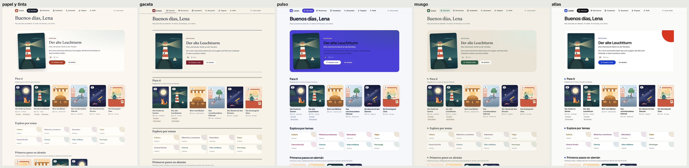

# Atlas: minimal premium con un guiño cultural

> Precisión: neutros casi blancos y casi negros, alto contraste, un único acento ultramar y el bermellón reservado para el
> «momento». Geometría en lugar de decoración.

## Concepto y personalidad

- **Idea:** el atlas de un viajero culto. Una rejilla estricta y blancos generosos, con formas geométricas (círculo,
  cuadrado) que evocan carteles y señalética cultural.
- **Origen:** fusiona las direcciones «Minimal premium» y «Experimental cultural» del encargo, para que lo minimal no
  quede vacío.
- **Personalidad:** sofisticada, segura, contemporánea y precisa.
- **Inspiración:** los carteles suizos y de la Bauhaus, la señalética de museos y las herramientas de software premium.
- **Por qué le sirve a Lesen:** es la que mejor transmite producto serio y caro sin perder cercanía. La lectura conserva
  Newsreader, que ya funciona.

## Color

- **Neutros:** `#fafaf8` y `#0e0f12`, con un contraste de tinta de 18,3:1.
- **Acción:** ultramar `#1c3fd1`, el único color de acción.
- **Momento:** bermellón `#d6361f` para el círculo de la destacada, las palabras nuevas y los logros. Nunca se usa en
  botones.
- **Foco:** también ultramar, para mantener un solo acento.
- **Oscuro:** negro tinta casi puro `#0c0c0e`, con superficies que suben en escalones definidos (`#17171b` y bordes
  `#2a2a30`). El ultramar pasa a pervinca `#8fa3ff`.
- **Lector:** papel casi blanco `#fffffd`, sepia neutro y oscuro casi negro.

#### Marca

| Token (CSS · semántico)                                               | Página clara | Página oscura | Lector claro | Lector sepia | Lector oscuro |
| --------------------------------------------------------------------- | ------------ | ------------- | ------------ | ------------ | ------------- |
| `--brand` · brand.primary — acción principal, enlaces fuertes         | `#1c3fd1`    | `#8fa3ff`     | `#1c3fd1`    | `#1a3ac2`    | `#8fa3ff`     |
| `--brand-strong` · brand.strong — pulsado, texto de marca sobre tinte | `#142fa3`    | `#b8c4ff`     | `#142fa3`    | `#12298f`    | `#b8c4ff`     |
| `--brand-soft` · brand.soft — seleccionado, hover de palabra          | `#e5e9fc`    | `#1b2350`     | `#e5e9fc`    | `#dfdff0`    | `#1b2350`     |
| `--on-brand` · text.onBrand — texto sobre la marca                    | `#ffffff`    | `#0a0f2e`     | `#ffffff`    | `#ffffff`    | `#0a0f2e`     |
| `--accent` · brand.accent — decoración (filetes, formas); nunca texto | `#d6361f`    | `#ff7a5c`     | `#d6361f`    | `#d6361f`    | `#ff7a5c`     |

#### Superficies

| Token (CSS · semántico)                                        | Página clara | Página oscura | Lector claro | Lector sepia | Lector oscuro |
| -------------------------------------------------------------- | ------------ | ------------- | ------------ | ------------ | ------------- |
| `--surface` · surface.default — fondo de la app / papel        | `#fafaf8`    | `#0c0c0e`     | `#fffffd`    | `#f3ecdd`    | `#0a0a0c`     |
| `--surface-muted` · surface.muted — secundaria, pistas         | `#f0f0ed`    | `#060607`     | `#f5f5f2`    | `#e9e0cc`    | `#050506`     |
| `--surface-raised` · surface.raised — tarjetas, hojas, popover | `#ffffff`    | `#17171b`     | `#ffffff`    | `#f8f2e5`    | `#141418`     |
| `--border` · border.subtle                                     | `#e2e2de`    | `#2a2a30`     | `#e5e5e0`    | `#d8cbb2`    | `#26262c`     |
| `--border-control` · border.control — bordes de campos (3:1)   | `#75756f`    | `#7a7a84`     | `#75756f`    | `#7a6d55`    | `#7a7a84`     |

#### Texto

| Token (CSS · semántico)                        | Página clara | Página oscura | Lector claro | Lector sepia | Lector oscuro |
| ---------------------------------------------- | ------------ | ------------- | ------------ | ------------ | ------------- |
| `--ink` · text.primary                         | `#0e0f12`    | `#f2f2ee`     | `#15161a`    | `#2f2a22`    | `#e6e6e1`     |
| `--ink-muted` · text.secondary                 | `#50525a`    | `#a8a8a2`     | `#55575e`    | `#5b5040`    | `#a0a09a`     |
| `--link` · text.link                           | `#142fa3`    | `#b8c4ff`     | `#142fa3`    | `#12298f`    | `#b8c4ff`     |
| `--focus` · state.focus — anillo de foco (3:1) | `#1c3fd1`    | `#8fa3ff`     | `#1c3fd1`    | `#1c3fd1`    | `#8fa3ff`     |

#### Semánticos

| Token (CSS · semántico)               | Página clara | Página oscura | Lector claro | Lector sepia | Lector oscuro |
| ------------------------------------- | ------------ | ------------- | ------------ | ------------ | ------------- |
| `--success` · state.success           | `#1e6b45`    | `#86cfa0`     | `#1e6b45`    | `#1e6b45`    | `#86cfa0`     |
| `--success-soft` · state.success.soft | `#e1f0e7`    | `#13281c`     | `#e1f0e7`    | `#e1f0e7`    | `#13281c`     |
| `--warning` · state.warning           | `#855000`    | `#e6bf6a`     | `#855000`    | `#855000`    | `#e6bf6a`     |
| `--warning-soft` · state.warning.soft | `#f6ebd3`    | `#2f250c`     | `#f6ebd3`    | `#f6ebd3`    | `#2f250c`     |
| `--danger` · state.error              | `#b42318`    | `#ff8a7a`     | `#b42318`    | `#b42318`    | `#ff8a7a`     |
| `--danger-soft` · state.error.soft    | `#fbe5e1`    | `#3a1814`     | `#fbe5e1`    | `#fbe5e1`    | `#3a1814`     |
| `--notice` · state.info               | `#19606f`    | `#7fcbd9`     | `#19606f`    | `#19606f`    | `#7fcbd9`     |
| `--notice-soft` · state.info.soft     | `#e0eef1`    | `#11282d`     | `#e0eef1`    | `#e0eef1`    | `#11282d`     |

#### Tonos de tema

| Token (CSS · semántico) | Página clara | Página oscura | Lector claro | Lector sepia | Lector oscuro |
| ----------------------- | ------------ | ------------- | ------------ | ------------ | ------------- |
| `--sea` · tone.sea      | `#19606f`    | `#7fcbd9`     | `#19606f`    | `#19606f`    | `#7fcbd9`     |
| `--sage` · tone.sage    | `#3e6a4a`    | `#9fcfaa`     | `#3e6a4a`    | `#3e6a4a`    | `#9fcfaa`     |
| `--ochre` · tone.ochre  | `#845a00`    | `#e6bf6a`     | `#845a00`    | `#845a00`    | `#e6bf6a`     |
| `--plum` · tone.plum    | `#7a3d6e`    | `#e0a6d4`     | `#7a3d6e`    | `#7a3d6e`    | `#e0a6d4`     |

#### Lector

| Token (CSS · semántico)                                  | Página clara | Página oscura | Lector claro | Lector sepia | Lector oscuro |
| -------------------------------------------------------- | ------------ | ------------- | ------------ | ------------ | ------------- |
| `--mark-saved` · reader.word.saved — fondo + punto       | `#ffe58f`    | `#4f4416`     | `#ffe58f`    | `#efd88c`    | `#4a3f14`     |
| `--mark-saved-ink` · reader.word.saved.ink               | `#0e0f12`    | `#fff3c8`     | `#15161a`    | `#2f2a22`    | `#fff3c8`     |
| `--mark-new` · reader.word.unknown — subrayado de puntos | `#d6361f`    | `#ff7a5c`     | `#d6361f`    | `#b52d18`    | `#ff7a5c`     |
| `--brand-soft` · reader.word.active — fondo + subrayado  | `#e5e9fc`    | `#1b2350`     | `#e5e9fc`    | `#dfdff0`    | `#1b2350`     |
| `--mark-sentence` · reader.sentence.active               | `#eceef8`    | `#1e2030`     | `#eef0f9`    | `#e8dfca`    | `#1b1d2b`     |
| `--success` · reader.word.known — subrayado continuo     | `#1e6b45`    | `#86cfa0`     | `#1e6b45`    | `#1e6b45`    | `#86cfa0`     |

#### Contraste medido (WCAG, sobre `surface`)

| Par                             | Página clara | Página oscura | Lector claro | Lector sepia | Lector oscuro |
| ------------------------------- | ------------ | ------------- | ------------ | ------------ | ------------- |
| `ink` / `surface`               | 18.3:1       | 17.4:1        | 18.1:1       | 12.1:1       | 15.8:1        |
| `ink-muted` / `surface`         | 7.5:1        | 8.2:1         | 7.2:1        | 6.7:1        | 7.5:1         |
| `brand` / `surface`             | 7.5:1        | 8.2:1         | 7.8:1        | 7.4:1        | 8.3:1         |
| `on-brand` / `brand`            | 7.8:1        | 7.9:1         | 7.8:1        | 8.6:1        | 7.9:1         |
| `mark-saved-ink` / `mark-saved` | 15.4:1       | 8.7:1         | 14.5:1       | 10.1:1       | 9.4:1         |
| `ink` / `mark-sentence`         | 16.6:1       | 14.3:1        | 15.9:1       | 10.7:1       | 13.3:1        |
| `mark-new` / `surface`          | 4.6:1        | 7.6:1         | 4.8:1        | 5.3:1        | 7.7:1         |
| `focus` / `surface`             | 7.5:1        | 8.2:1         | 7.8:1        | 6.7:1        | 8.3:1         |

## Tipografía

| Papel                | Familia                                | Por qué                                                                                  |
| -------------------- | -------------------------------------- | ---------------------------------------------------------------------------------------- |
| Titulares e interfaz | **Geist** (100–900)                    | Grotesca contemporánea, precisa y neutra; en 600 con tracking cerrado da el tono premium |
| Lectura              | **Newsreader** (la actual, eje óptico) | Se conserva: ya está probada para lectura larga y su contraste serif/sans es la firma    |

- **Pesos:** 600 en display y en h1–h4, para una jerarquía por tamaño y no por peso. Las etiquetas van a 550.
- **Tracking:** −0,045 em en display, −0,035 em en h1 y −0,028 em en h2.
- **Peso de carga:** unos 156 KB, igual que hoy, porque Newsreader ya está.
- **Riesgo:** el tracking muy cerrado en titulares alemanes largos. Con −0,035 em es aceptable hasta unos 24
  caracteres; más allá conviene −0,025 em.

## Lenguaje de componentes

- **Radios:** pequeños (tarjetas de 6 px). Botones y chips en píldora: el contraste entre rectángulo y círculo es parte
  de la geometría.
- **Sombras:** ninguna. Bordes de 1 px (tinta al 8 %) y una sombra mínima solo en las superficies flotantes.
- **La destacada:** plana, con un círculo bermellón que asoma por la esquina y la portada recta.
- **Titulares de sección:** un cuadrado ultramar delante.
- **Navegación:** píldora de tinta, como hoy; con Geist se lee más precisa.
- **Progreso:** anillos finos de 2 px y cifras en Geist con cifras tabulares.
- **Popover del diccionario:** blanco, borde de 1 px y radio de 8 px.
- **Reproductor:** círculo ultramar.
- **Logros:** un círculo que se completa; el logro conseguido se rellena de bermellón.
- **Estados vacíos:** una composición geométrica (círculo y cuadrado) en lugar de una ilustración.

## Movimiento

Preciso y corto:

- Transiciones de 120–180 ms con `ease-out`, sin rebotes.
- **Guardar una palabra:** el punto bermellón aparece con un trazo.
- **Hojas y popover:** se desplazan 12 px y aparecen con un fundido de 180 ms.
- **Movimiento reducido:** todo es instantáneo.

## Accesibilidad

- Es la de mayor contraste en todos los temas.
- El bermellón llega a 4,6:1 (más que el 3:1 de una marca no textual), pero no se usa como texto.
- Riesgo: el foco tiene el mismo color que la marca. Sobre un botón ultramar, el anillo de 3 px con 2 px de separación
  sigue viéndose porque se dibuja sobre el fondo, no sobre el botón.

## Ventajas e inconvenientes

**Ventajas**

- La de aspecto más premium y profesional.
- Alto contraste.
- Peso de fuente igual que hoy.
- La geometría es fácil de extender a iconos, logros y estados vacíos sin ilustrador.
- Escala muy bien.

**Inconvenientes**

- La menos cálida.
- Sin la firma geométrica caería en lo genérico.
- Las portadas ilustradas y cálidas contrastan con la interfaz fría, y hay que decidir si eso es virtud o choque.

## Implicaciones de implementación

- **Web:** firma pequeña, con pseudoelementos geométricos. Aplicar `font-variant-numeric: tabular-nums` a las cifras del
  progreso.
- **Flutter:** una TTF nueva, Geist (unos 0,3 MB), porque Newsreader ya está. Los círculos son un `CustomPainter`
  sencillo.
- **Coste estimado:** bajo.
